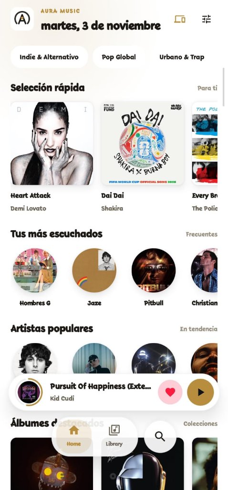
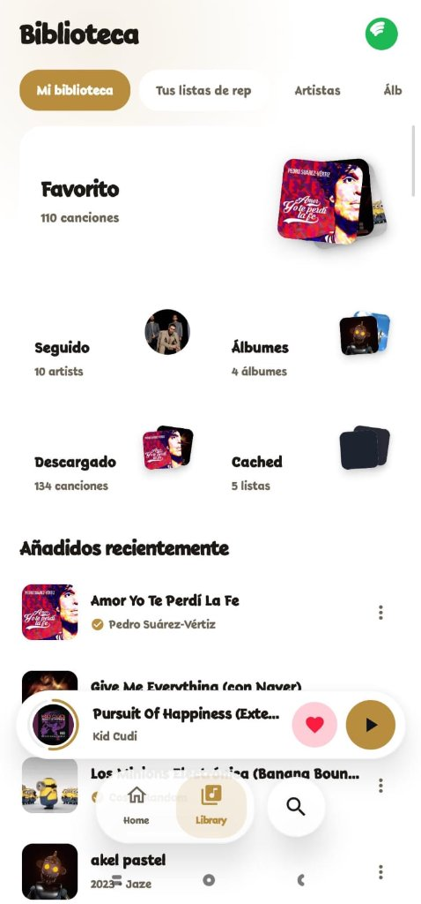
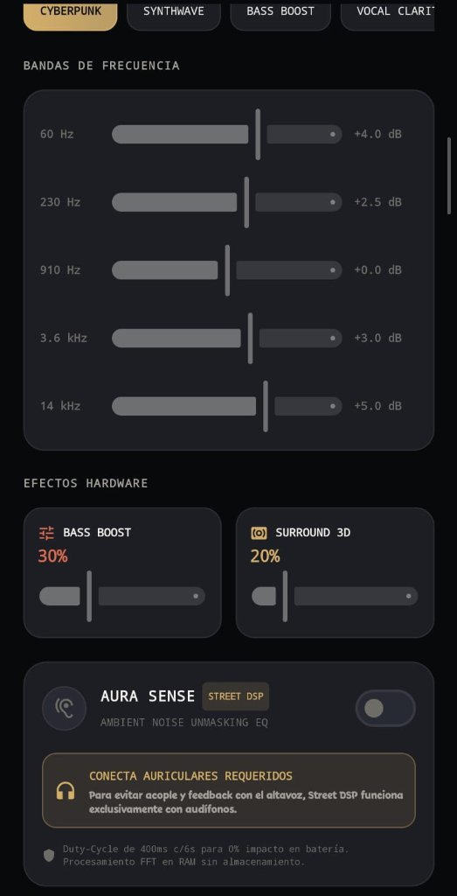
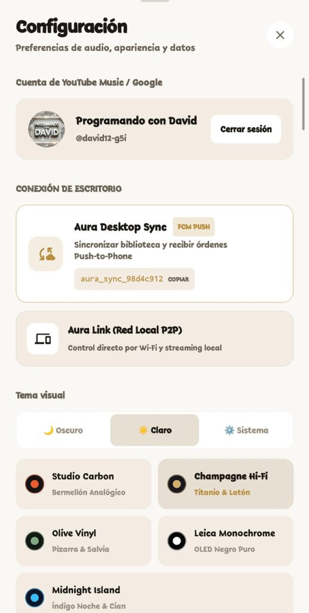
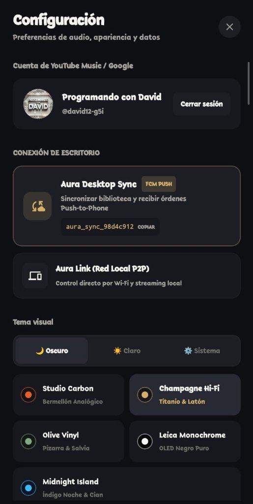

# 🎵 AURA MUSIC (Android)

### **Reproductor de música flotante, ultra-rápido y con estética Cyberpunk para Android.**
*La experiencia definitiva de streaming libre, ecualización DSP por hardware y sincronización multiplataforma.*

 

[📥 **Descargar APK Release (Recomendado - 61 MB)**](releases/AuraMusic-v2.1.4-Release.apk) &nbsp;•&nbsp; [🛠️ **Descargar APK Debug (83 MB)**](releases/AuraMusic-v2.1.4-Debug.apk) &nbsp;•&nbsp; [📦 **Ver Todas las Versiones (GitHub Releases)**](https://github.com/respaldoperez348-rgb/AURA-MUSIC-ANDROID/releases)

---

## 📸 Galería de la Aplicación

<table>
  <tr>
    <td align="center" width="20%">
      
        
      <b>01. Inicio & Feed</b>
       
      Descubrimiento dinámico en tema Champagne Hi-Fi
    </td>
    <td align="center" width="20%">
      
        
      <b>02. Tu Biblioteca</b>
       
      Favoritos, álbumes, listas y descargas offline
    </td>
    <td align="center" width="20%">
      
        
      <b>03. Hardware DSP</b>
       
      Ecualizador 5 bandas, BassBoost y Aura Sense
    </td>
    <td align="center" width="20%">
      
        
      <b>04. Desktop Sync</b>
       
      Sincronización remota Push-to-Phone vía FCM
    </td>
    <td align="center" width="20%">
      
        
      <b>05. Temas Cyberpunk</b>
       
      Paletas de estudio en Modo Oscuro (Studio Carbon)
    </td>
  </tr>
</table>

> *Nota: Próximamente se integrarán las capturas del reproductor Studio Deck y las letras karaoke sincronizadas.*

---

## ⚡ ¿Qué nos diferencia de la competencia?

Aura Music fue diseñado desde cero para superar las limitaciones de plataformas como **Spotify, YouTube Music, ViMusic e InnerTune**:

| Característica | **Aura Music** | Spotify / YT Music | Otras Apps Libres |
| :--- | :---: | :---: | :---: |
| **Cero Publicidad & 100% Gratuito** | ✅ **Totalmente libre** | ❌ Requiere suscripción | ✅ Libre |
| **Latencia de Reproducción** | ⚡ **Ultra-rápido (~250 ms)** | ⚠️ 1.5 - 3 s de buffer | ⚠️ 2 - 4 s de espera |
| **Salto de Canción (Next/Skip)** | 🚀 **0 ms (Fast-Path en RAM)** | ⚠️ Recarga de red | ⚠️ Descarga repetida |
| **Hardware DSP & Aura Sense** | 🎛️ **5 Bandas + Street DSP** | ⚠️ EQ básico por software | ❌ Sin DSP por hardware |
| **Sincronización Móvil ↔ PC** | 🔄 **Aura Sync (Push-to-Phone)** | ⚠️ Solo Spotify Connect | ❌ Inexistente |
| **Biblioteca Local Real** | 📂 **Android 10+ Thumbnails** | ❌ Restringido / Bloqueado | ⚠️ Fallas en Android 10+ |
| **Temas Visuales Dinámicos** | 🎨 **5 Temas (Claro / Oscuro)** | ❌ Tema único rígido | ⚠️ Pocos temas básicos |
| **Importador de Spotify** | 📥 **Nativo en 1 Clic** | ❌ No disponible | ⚠️ Scripts externos |

---

## 🚀 Funcionalidades Destacadas

### 1. ⚡ Motor de Audio Ultra-Rápido & Buffer Cero
- **Pipeline de Precarga en Cola**: Mientras escuchas una pista, el motor precarga en memoria RAM las URL de las siguientes 3 canciones (`+1, +2, +3`) y la anterior (`-1`). Al pulsar *Siguiente*, el cambio es inmediato.
- **Fast-Path en ExoPlayer**: Transición sin pausas (gapless) de 0 ms entre canciones consecutivas.
- **Extracción Híbrida Inteligente**: Canal ultra-rápido de baja latencia con respaldo automático a NewPipe extractor y caché en disco de 64 MB para scripts de audio.
- **Prioridad Absoluta de Reproducción**: La pista seleccionada tiene prioridad total de ancho de banda; las letras y la radio inteligente inician en segundo plano tras arrancar el sonido.

### 2. 🎛️ Suite de Audio Profesional (Hardware DSP)
- **Ecualizador de 5 Bandas**: Control milimétrico de frecuencias (60 Hz, 230 Hz, 910 Hz, 3.6 kHz, 14 kHz) con presets de estudio (*Cyberpunk, Synthwave, Bass Boost, Vocal Clarity, Flat*).
- **Efectos de Hardware**: *Bass Boost* profundo y procesador envolvente *3D Surround Virtualizer*.
- **Aura Sense (Street DSP)**: Compensación dinámica de ruido ambiental en tiempo real mediante análisis FFT de baja latencia (exclusivo para auriculares).

### 3. 🔄 Aura Desktop Sync (Ecosistema Multiplataforma)
- **Push-to-Phone en Tiempo Real**: Envía pistas y órdenes de reproducción desde el reproductor de escritorio (Windows/Linux) directo a tu teléfono móvil mediante Firebase Cloud Messaging (FCM).
- **Aura Link (Red Local P2P)**: Control directo por Wi-Fi y streaming local sin depender de servidores externos.

### 4. 🎨 Diseño Frosted Glass & Paletas de Autor
- **5 Temas de Estudio**:
  - 🔴 **Studio Carbon**: Bermellón analógico sobre carbono mate.
  - 🟡 **Champagne Hi-Fi**: Titanio, latón y estética vintage de alta fidelidad.
  - 🟢 **Olive Vinyl**: Pizarra y salvia para sesiones relajantes.
  - ⚪ **Leica Monochrome**: Negro puro OLED y contraste fotográfico.
  - 🔵 **Midnight Island**: Índigo noche y cian neón.
- **Soporte Verdadero para Modo Claro y Oscuro**: Adaptación visual completa para uso bajo el sol o en la noche.

### 5. 🎤 Letras Sincronizadas & Traducción
- **Karaoke en Tiempo Real**: Letras sincronizadas línea por línea integradas con motor LRCLIB.
- **Ajuste Fino de Desfase**: Calibración milimétrica para sincronizar el texto perfectamente con el ritmo vocal.
- **Traducción Integrada**: Visualización bilingüe de letras para canciones en otros idiomas.

### 6. 📂 Colecciones & Descargas Offline
- **Descargas Reales al Almacenamiento**: Guarda canciones directamente con carátula y metadatos incrustados.
- **Escáner Local Moderno**: Compatible con las directivas de seguridad de Android 10+ (Scoped Storage) extrayendo carátulas en alta resolución mediante `AudioThumbnailFetcher`.
- **Importador desde Spotify**: Convierte tus playlists de Spotify a Aura Music con solo pegar el enlace.

---

## 📦 Descargas Disponibles

| Versión | Archivo | Tamaño | Descripción |
| :--- | :--- | :---: | :--- |
| **Release (Recomendado)** | [`AuraMusic-v2.1.4-Release.apk`](releases/AuraMusic-v2.1.4-Release.apk) | **61 MB** | Compilación optimizada al 100%, sin overhead de depuración y máxima fluidez en Compose. |
| **Debug** | [`AuraMusic-v2.1.4-Debug.apk`](releases/AuraMusic-v2.1.4-Debug.apk) | **83 MB** | Incluye logs de desarrollo, inspección de red y herramientas de diagnóstico. |

> Todas las versiones históricas están archivadas en la sección de [Releases de GitHub](https://github.com/respaldoperez348-rgb/AURA-MUSIC-ANDROID/releases).

---

## 🛠️ Stack Tecnológico

- **Lenguaje**: [Kotlin 2.2+](https://kotlinlang.org/)
- **Interfaz**: [Jetpack Compose](https://developer.android.com/jetpack/compose) + Material 3 Expressive
- **Motor de Audio**: [AndroidX Media3 1.5 (ExoPlayer & MediaSession)](https://developer.android.com/media/media3)
- **DSP por Hardware**: Android AudioFX (`Equalizer`, `BassBoost`, `Virtualizer`)
- **Procesamiento de Red**: OkHttp 4 con caché LRU de 64 MB
- **Carga de Imágenes**: Coil Compose + Fetcher custom para miniaturas locales
- **Persistencia**: SQLite nativo de alto rendimiento (`AuraDatabase`)
- **CI/CD**: GitHub Actions con compilación y firma automatizada

---

## 👨‍💻 Autor & Créditos

Desarrollado con pasión por **David Tineo** ([@respaldoperez348-rgb](https://github.com/respaldoperez348-rgb)).

---

## 📄 Licencia

Este proyecto está bajo la Licencia **MIT**. Consulta el archivo [LICENSE](LICENSE) para más detalles.
