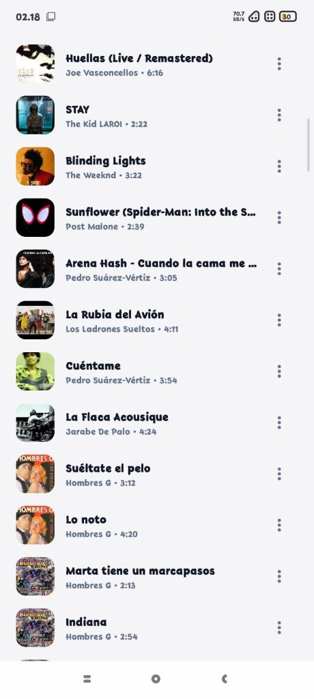
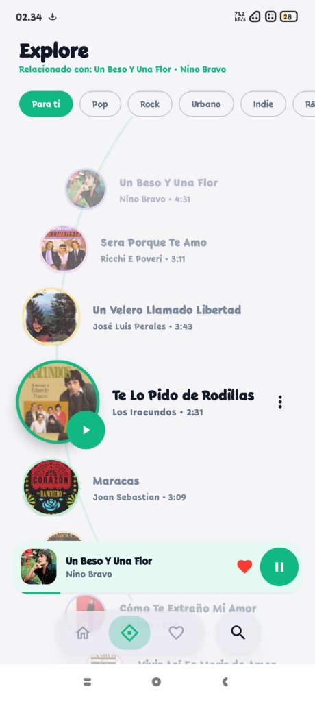
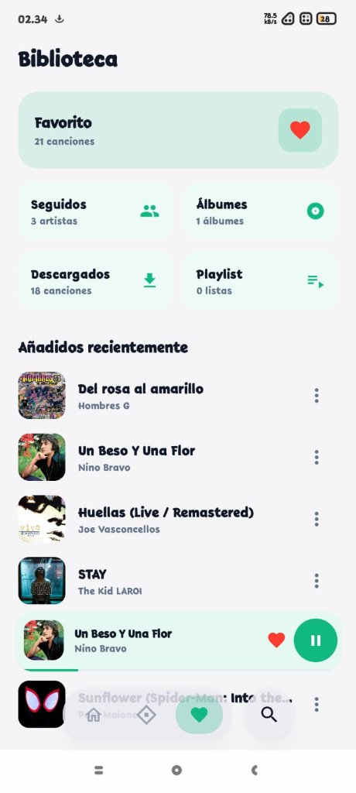
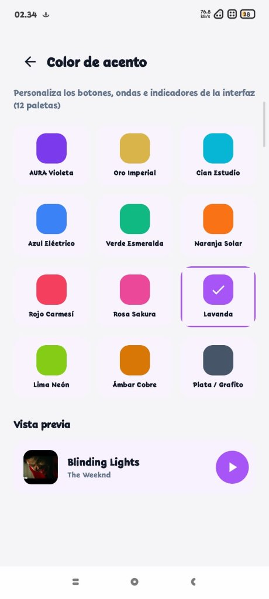
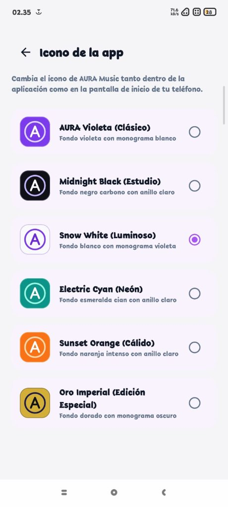
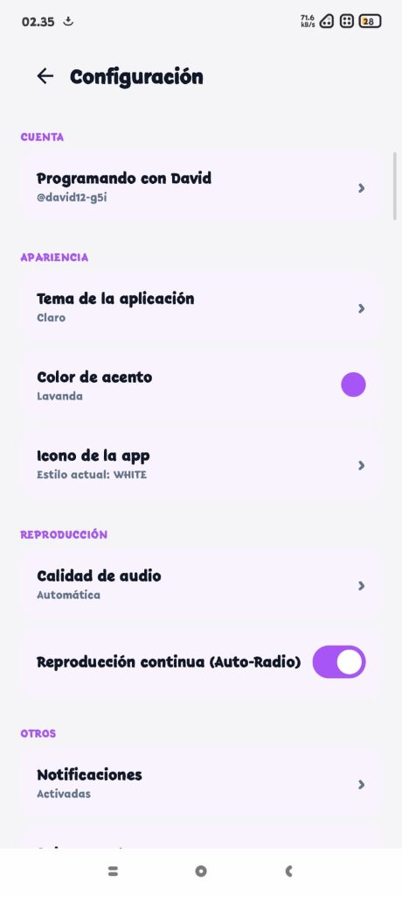

# AURA Music (Android) — v3.0.0

<div align="center">

### **Reproductor de música moderno, rápido y personalizable para Android**
*Streaming en tiempo real con motor Innertube (`WEB_REMIX`), descargas offline con notificaciones del sistema, letras sincronizadas y diseño expresivo en Jetpack Compose.*

[](https://github.com/respaldoperez348-rgb/AURA-MUSIC-ANDROID/releases/tag/v3.0.0)
[-10B981?style=for-the-badge&logo=android&logoColor=white)](#)
[](#)
[](#)
[](#)
[](#)

**Creado por David Tineo**

<br/>

[**Descargar APK Release v3.0.0 (Recomendado - 20 MB)**](releases/AuraMusic-v3.0.0-Release.apk) &nbsp;•&nbsp; [**Descargar APK Debug v3.0.0 (28 MB)**](releases/AuraMusic-v3.0.0-Debug.apk) &nbsp;•&nbsp; [**Ver Lanzamiento Oficial (GitHub Releases)**](https://github.com/respaldoperez348-rgb/AURA-MUSIC-ANDROID/releases)

</div>

---

## 📸 Capturas de Pantalla

<div align="center">

<table>
  <tr>
    <td align="center" width="33%">
      
      <br/><br/>
      <b>01. Catálogo y Tendencias</b>
      <br/>
      <sub>Carátulas verificadas de alta resolución y acceso rápido a opciones</sub>
    </td>
    <td align="center" width="33%">
      
      <br/><br/>
      <b>02. Explore en Caracol Dinámico</b>
      <br/>
      <sub>Recomendaciones en espiral adaptadas al género de lo que escuchas</sub>
    </td>
    <td align="center" width="33%">
      
      <br/><br/>
      <b>03. Biblioteca & Barra Flotante</b>
      <br/>
      <sub>Favoritos, Seguidos, Álbumes, Descargados y Playlists con persistencia SQLite</sub>
    </td>
  </tr>
  <tr>
    <td align="center" width="33%">
      
      <br/><br/>
      <b>04. 12 Colores de Acento</b>
      <br/>
      <sub>Personalización en vivo de botones, ondas e indicadores con vista previa</sub>
    </td>
    <td align="center" width="33%">
      
      <br/><br/>
      <b>05. Icono Dinámico del Launcher</b>
      <br/>
      <sub>6 estilos de icono que se actualizan en el cajón de aplicaciones de Android</sub>
    </td>
    <td align="center" width="33%">
      
      <br/><br/>
      <b>06. Configuración y Cuenta</b>
      <br/>
      <sub>Sincronización con cuenta de Google/YouTube Music, temas, calidad de audio y Auto-Radio</sub>
    </td>
  </tr>
</table>

</div>

---

## ✨ Características Principales

- **Motor de Audio AndroidX Media3 (`ExoPlayer` + `MediaSessionService`)**:
  - Reproducción en segundo plano con controles nativos en el **Centro de Notificaciones** y pantalla de bloqueo.
  - **Auto-Radio (Reproducción continua)** inteligente que encola pistas relacionadas al finalizar la cola.
  - Resolución multi-cliente de flujos de audio (`IOS`, `ANDROID_VR`, `TVHTML5_SIMPLY_EMBEDDED_PLAYER`) con renovación automática de URLs expiradas.
- **Descubrimiento y Búsqueda en Tiempo Real (`WEB_REMIX` / `:innertube`)**:
  - **Inicio**: Selección rápida, *Tus más escuchados* (historial real), Artistas populares, Álbumes destacados y Tendencias globales.
  - **Explore en Caracol**: Curva espiral interactiva que se actualiza automáticamente según la canción o género que estés reproduciendo (*Para ti*, *Pop*, *Rock*, *Urbano*, *Indie*, *R&B*, *Electrónica*, *Clásicos*).
  - **Buscador con Sugerencias**: Autocompletado en tiempo real, filtros por Canciones/Artistas/Álbumes e indicador directo cuando una canción ya está en tus Favoritos.
- **Perfiles Completos de Artistas y Álbumes**:
  - Cabecera inmersiva de artista con insignia verificada, canciones populares, cuadrícula de álbumes, sencillos y pestaña **Sobre** con biografía, datos del artista y artistas relacionados interactivos.
- **Letras Sincronizadas (LRC)**:
  - Resaltado línea por línea sincronizado con el tiempo de reproducción y ocultamiento automático de la caja de controles para lectura a pantalla completa.
- **Descargas Offline con Notificaciones del Sistema**:
  - Descarga real a almacenamiento local con barra de progreso en el centro de notificaciones de Android y gestión directa (*Descargar* / *Eliminar descarga*).
- **Personalización Total**:
  - **7 Temas**: *Claro*, *Oscuro Estudio*, *Negro Puro AMOLED*, *Noche Violeta*, *Carbono Marino*, *Café Nocturno* y *Automático*.
  - **12 Colores de acento** y **6 Iconos dinámicos** para la pantalla de inicio del teléfono.

---

## 🏗️ Arquitectura del Proyecto

```text
Reproductor/
├── app/                  # Aplicación principal Android (Jetpack Compose + Media3 + SQLite)
│   └── src/main/kotlin/com/auramusic/app/
│       ├── data/         # Modelos, base de datos SQLite (UserManager) y MusicRepository
│       ├── playback/     # PlayerManager y AuraMusicService (MediaSessionService)
│       └── ui/           # Pantallas Compose, barra flotante segmentada, temas y componentes
├── innertube/            # Módulo Kotlin puro para cliente YouTube Music / Innertube (Ktor + Serialization)
├── releases/             # Paquetes instalables oficiales de AURA Music v3.0.0 (Release & Debug)
└── screenshots/          # Capturas oficiales de AURA Music v3.0.0
```

---

## 🚀 Compilación desde Código Fuente

1. Clona el repositorio:
   ```bash
   git clone git@github.com:respaldoperez348-rgb/AURA-MUSIC-ANDROID.git
   cd AURA-MUSIC-ANDROID
   ```
2. Compila el APK con Gradle:
   ```bash
   ./gradlew assembleRelease
   ```
3. El APK generado estará disponible en:
   `app/build/outputs/apk/release/app-release.apk`

---

## 👤 Autor y Licencia

- **Creador:** David Tineo
- **Repositorio Oficial:** [github.com/respaldoperez348-rgb/AURA-MUSIC-ANDROID](https://github.com/respaldoperez348-rgb/AURA-MUSIC-ANDROID)
- **Licencia:** Distribuido bajo la licencia **GNU General Public License v3.0 (GPL-3.0)**.
